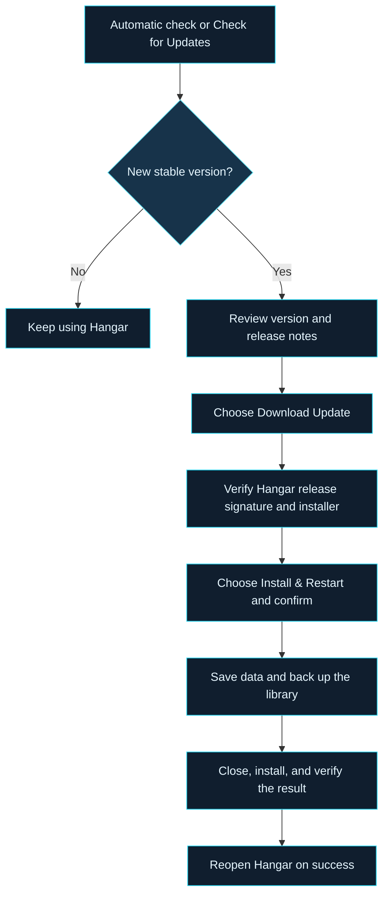

# HANGAR
### Organize. Prepare. Fly.

**Your Windows companion for Microsoft Flight Simulator 2024.**

[Downloads](#downloads) · [Automatic Updates](#automatic-updates) · [Distribution Contents](#distribution-contents) · [Help](#help)

---

Official distribution information for **Hangar**. This repository is reserved for installer releases and update metadata; desktop application development is maintained privately.

## Downloads

> **Hangar v1.5.1 is available.** [Download the Windows x64 installer](https://github.com/TheAddonArchitect/Hangar-Updates/releases/download/v1.5.1/Hangar-Setup-1.5.1-win-x64.exe) · [Release notes and verification files](https://github.com/TheAddonArchitect/Hangar-Updates/releases/tag/v1.5.1)

The [developer's flightsim.to profile](https://flightsim.to/profile/TheAddonArchitect) is also available. A direct Hangar product listing has not been provided; installers are available in this repository's [Releases](https://github.com/TheAddonArchitect/Hangar-Updates/releases/latest).

### First installation

1. Open the [latest release](https://github.com/TheAddonArchitect/Hangar-Updates/releases/latest) and review its notes.
2. Download the Windows x64 installer provided with the release.
3. Run the installer and follow the setup prompts.
4. Launch Hangar and configure your simulator, Community, and addon-library locations.

The installer is configured for a per-user installation in `%LOCALAPPDATA%\Programs\Hangar`. Application data is kept separately in `%LOCALAPPDATA%\Hangar`, unless a custom data location is configured.

**Compatibility:** Windows x64 is the build target, with Microsoft Flight Simulator 2024 required for simulator-related features. Windows installation, upgrade, startup, and data-preservation checks run in automated Windows tests; these checks do not certify every aircraft, simulator addon, or cockpit integration.

**One-time setup:** Install this release manually to establish Hangar's trusted update key. Older builds that require a Windows publisher certificate cannot automatically switch to the new verification method. Subsequent updates require no GitHub login.

**Windows publisher notice:** The installer does not have a Windows code-signing certificate. Windows may display an unknown-publisher warning or block it. Hangar's release signature authenticates in-app updates; it does not disable or replace Windows security protections.

## Automatic Updates

**Automatic checks. You control installation.**

The current updater implementation enables automatic checks by default: at startup when a check is due, then every six hours while Hangar is running. Update checks and downloads do not require an account or sign-in. Internet access is required.

Select **Check for Updates** in the sidebar to check immediately. The **Application Updates** panel shows the installed version, update status, and available release notes. Use **Check Again** to retry, or turn off **Automatically check for updates**; the preference is saved.

### What happens during an update

- **Download and installation are separate actions.** Downloading does not close Hangar. You can choose **Later** at the installation confirmation.
- **Verification happens before installation.** Hangar verifies the signed release manifest against its built-in public key, then checks the installer's size, SHA-256 checksum, and version. The separate updater repeats verification before running it.
- **Finish active work first.** Installation is blocked during a library operation or flight recording, and if library storage is unhealthy.
- **Your data stays separate.** The installer replaces application files; settings, addon records, thumbnails, and saved profiles remain in the data folder. Hangar saves a pre-update library backup before starting installation.
- **Restart follows a successful installation.** The updater verifies the signed file inventory, installed application files, and version before reopening Hangar. If Windows needs a restart, it asks you to restart Windows first.

> **Release verification:** Version 1.5.1 uses RSA-PSS/SHA-256 signed metadata and a pinned Hangar verification key. Manifests from another key, altered installers, and same-version or older installs are rejected. Development builds without signed metadata are not accepted.

## Distribution Contents

These files are available from each published release. Only installers and update metadata are distributed here; application source code remains private.

### Release files

| Item | Purpose |
|:---|:---|
| `Hangar-Setup-<version>-win-x64.exe` | Windows x64 installer authenticated by the signed release manifest; no Windows publisher certificate |
| `update-stable.json` | Signed metadata binding the release version, repository, installer, size, hashes, architecture, and installed file inventory |
| `SHA256SUMS.txt` | SHA-256 checksum for the installer |
| Public release notes | Release information displayed alongside the download and in the update panel; not a separate download asset |

### Inside the installer

| Component | Purpose |
|:---|:---|
| Hangar desktop application | Application binaries, resources, and bundled .NET / Windows App SDK runtime components |
| `Hangar.Updater.exe` | Separate helper for verified installation and restart |
| `release-files.json` | Signed inventory used to verify the updater and installed application files |
| `Hangar-Cockpit.zip` | Packaged in-simulator companion addon; inclusion does not mean automatic installation into the simulator |
| User guide and supporting assets | Bundled PDF guide, application documentation, fonts, images, and embedded reference data |
| License and third-party notices | Terms and notices shipped with the application |

AI model files are not bundled by this packaging process. Your addon collection, personal settings, and saved library data are not part of the installer.

## Help

| Situation | Next step |
|:---|:---|
| Hangar is up to date | Your installed version matches or exceeds the current stable release. |
| Update check fails or the server is busy | Check your connection and try **Check Again** later. Background failures do not interrupt your work. |
| Installation is unavailable | An older or development build may lack the pinned key or signed inventory. Install the complete official release once. |
| Verification fails | Do not run that download manually to bypass verification. Retry through Hangar or obtain a fresh download from the official release. |
| Installation fails | Keep the data folder intact. Update logs and the pre-update library backup remain under its `Updates` folder for troubleshooting. |

The [developer profile](https://flightsim.to/profile/TheAddonArchitect) provides project information. When reporting a problem, include the Hangar version, Windows version, error message, and steps to reproduce; remove private information from logs and screenshots.

---

**HANGAR · Your Simulator. Your Addons. One Hangar.**

Independent third-party software for Microsoft Flight Simulator 2024. Not affiliated with or endorsed by Microsoft or Asobo Studio. For simulation use only.

