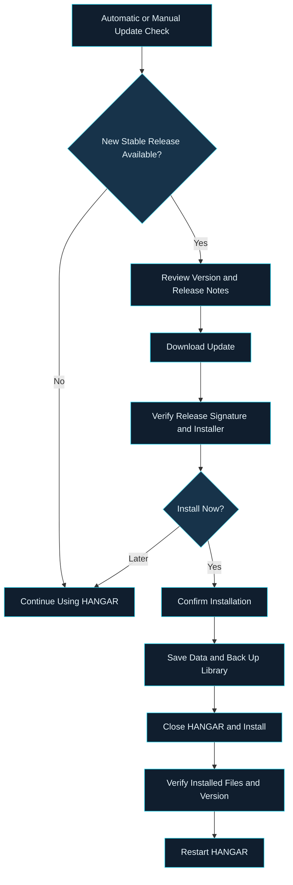

# HANGAR — README.md

```html
<div align="center">

<h1><strong>HANGAR</strong></h1>

<h3>Organize. Prepare. Fly.</h3>

<p><strong>Your Simulator. Your Addons. One Hangar.</strong></p>

<p>
A modern Windows companion designed to simplify addon management,
flight preparation, and simulator integration for Microsoft Flight Simulator 2024.
</p>


<br>

[**Download HANGAR**](https://github.com/TheAddonArchitect/Hangar-Updates/releases/latest) ·
[**Release Notes**](https://github.com/TheAddonArchitect/Hangar-Updates/releases/tag/v1.5.1) ·
[**Report an Issue**](https://github.com/TheAddonArchitect/Hangar-Updates/issues)

<br>

**[Overview](#overview) • [Installation](#installation) • [Automatic Updates](#automatic-updates) • [Distribution](#distribution-contents) • [Troubleshooting](#troubleshooting) • [Support](#support)**

</div>

---

## Overview

**HANGAR** is a Windows desktop companion built for the Microsoft Flight Simulator 2024 community.

Designed to bring essential simulator utilities into one organized environment, HANGAR provides a centralized workspace for managing addons, preparing flights, and accessing simulator-related tools.

Whether you're maintaining an extensive addon library or preparing for your next flight, HANGAR helps keep your simulator environment organized and accessible.

### Core Capabilities

| Feature | Description |
|:---|:---|
| **Addon Library** | Organize and manage your aircraft, airports, scenery, liveries, and other simulator addons. |
| **Flight Planning** | Access flight preparation and route-planning utilities. |
| **Scenery Map** | Explore and visualize scenery locations within your simulator environment. |
| **Flight Logbook** | Maintain records of your simulator flights and flight activity. |
| **Companion Center** | Access simulator companion utilities and integrations. |
| **Simulator Integration** | Configure simulator connections and related functionality. |
| **User Guide** | Access built-in documentation and application guidance. |
| **Automatic Updates** | Check for verified releases and install updates when convenient. |

> **Development Notice**
>
> HANGAR is independently developed and maintained by **TheAddonArchitect**.
>
> This repository serves as the official distribution channel for Windows installers, release information, and secure update metadata.
>
> Application source code and active desktop development are maintained privately.

---

## Downloads

### Latest Stable Release

**HANGAR v1.5.1**

The current published release is available for Windows x64.

[**Download HANGAR v1.5.1 — Windows x64 Installer**](https://github.com/TheAddonArchitect/Hangar-Updates/releases/download/v1.5.1/Hangar-Setup-1.5.1-win-x64.exe)

**Additional Resources**

- [Latest Stable Release](https://github.com/TheAddonArchitect/Hangar-Updates/releases/latest)
- [Version 1.5.1 Release Notes](https://github.com/TheAddonArchitect/Hangar-Updates/releases/tag/v1.5.1)
- [All Published Releases](https://github.com/TheAddonArchitect/Hangar-Updates/releases)
- [Developer Profile on Flightsim.to](https://flightsim.to/profile/TheAddonArchitect)

> **Official Downloads**
>
> Download HANGAR exclusively from the official GitHub Releases page or another distribution channel explicitly identified by the developer.
>
> A direct Flightsim.to product listing is not currently provided in this document.

---

## System Requirements

| Requirement | Specification |
|:---|:---|
| **Operating System** | Windows x64 |
| **Simulator** | Microsoft Flight Simulator 2024 |
| **Architecture** | 64-bit (x64) |
| **Internet Connection** | Required for release checks and update downloads |
| **Installation Type** | Per-user Windows installation |
| **Application Runtime** | Required .NET and Windows App SDK runtime components bundled with the installer |

Microsoft Flight Simulator 2024 is required for simulator-dependent functionality.

**Compatibility Notice**

HANGAR undergoes automated Windows installation, upgrade, startup, and data-preservation testing.

These tests do not guarantee compatibility with every third-party aircraft, scenery package, simulator addon, or cockpit integration.

---

## Installation

### First-Time Installation

Follow these steps to install HANGAR:

1. Visit the [official Releases page](https://github.com/TheAddonArchitect/Hangar-Updates/releases/latest).
2. Review the latest release notes and compatibility information.
3. Download the Windows x64 installer.
4. Run the downloaded installer.
5. Follow the on-screen installation instructions.
6. Launch HANGAR after installation.
7. Configure your simulator, Community folder, and addon-library locations.

### Installation Directories

HANGAR separates application files from user-generated data.

**Application Installation**

```text
%LOCALAPPDATA%\Programs\Hangar\
```

**Application Data**

```text
%LOCALAPPDATA%\Hangar\
```

Unless a custom data location is configured, application settings and saved library information are maintained in the default application-data directory.

This separation allows application updates to replace program files without intentionally overwriting your personal configuration.

### Important First-Installation Notice

**Version 1.5.1 must be installed manually when migrating from older updater implementations.**

This establishes HANGAR's trusted release-verification key.

Older builds that depend on Windows publisher-certificate verification cannot automatically transition to the newer signed-manifest verification system.

Once the current release is installed, subsequent supported updates can be checked and downloaded without a GitHub account.

### Windows Security Notice

The HANGAR installer is not currently signed with a Windows code-signing certificate.

Windows may display an **Unknown Publisher** warning or prevent the installer from running.

HANGAR uses cryptographic signatures to authenticate application updates. However, these signatures do not replace Windows code-signing requirements or bypass Windows security protections.

Always verify that the installer was obtained from an official release.

---

## Automatic Updates

### Secure Updates. Complete Control.

HANGAR includes an integrated update system designed to make receiving new releases straightforward while keeping installation decisions in your control.

**Automatic update checks are enabled by default.**

The application checks for available stable releases:

- At startup when an update check is due.
- Every six hours while HANGAR remains running.
- Whenever you manually request an update check.

Update checks and downloads require internet connectivity but do not require a GitHub account or sign-in.

### Managing Updates

Open **Check for Updates** from the application sidebar.

The **Application Updates** panel provides access to:

| Control | Function |
|:---|:---|
| **Installed Version** | Displays the currently installed HANGAR version. |
| **Update Status** | Shows whether a newer stable release is available. |
| **Release Notes** | Displays information about an available release. |
| **Check Again** | Immediately repeats the update check. |
| **Download Update** | Downloads an available release for verification. |
| **Install & Restart** | Starts the confirmed installation and restart process. |
| **Automatically Check for Updates** | Enables or disables scheduled update checks. |

Your automatic-update preference is saved between application sessions.

### Update Process



### Update Safety and Data Protection

HANGAR's updater incorporates multiple safeguards.

**1. Download and Installation Are Separate**

Downloading an update does not automatically close the application or begin installation.

You may review the available update and select **Later** when prompted to install.

**2. Release Verification**

Before installation, HANGAR:

- Validates the signed release manifest against its embedded public verification key.
- Checks the installer size.
- Verifies the SHA-256 checksum.
- Confirms the release version.
- Rejects unsupported or invalid release metadata.

The separate updater performs additional verification before executing the installation.

**3. Active Operations Are Protected**

Installation is blocked when:

- An addon-library operation is running.
- A flight recording is active.
- Library storage is in an unhealthy state.

Complete active operations before installing an update.

**4. User Data Is Preserved**

Application updates replace installed application files while keeping user data in its separate storage location.

Preserved information includes:

- Application settings.
- Addon-library records.
- Thumbnails and associated metadata.
- Saved profiles.
- Other persistent application data.

HANGAR also creates a pre-update library backup before installation begins.

**5. Installation Verification and Restart**

After installation, the updater verifies:

- The signed file inventory.
- Installed application files.
- The installed application version.

HANGAR reopens after successful verification.

If Windows requires a system restart, the updater requests that restart before continuing.

### Cryptographic Release Verification

HANGAR v1.5.1 uses **RSA-PSS with SHA-256** for signed release metadata.

The verification system uses a pinned public key to authenticate official release manifests.

The updater rejects:

- Manifests signed using an untrusted key.
- Modified or corrupted installer files.
- Invalid file hashes or release metadata.
- Same-version or older installation attempts.
- Development builds without valid signed release metadata.

> **Security Note**
>
> HANGAR's signed-update mechanism is designed to protect the integrity and authenticity of supported application updates.
>
> It does not replace Windows SmartScreen, antivirus software, or operating-system security controls.

---

## Distribution Contents

This repository distributes official HANGAR installers and supporting update metadata.

**The desktop application's source code is not included in public releases.**

### Published Release Assets

| File | Description |
|:---|:---|
| `Hangar-Setup-<version>-win-x64.exe` | Windows x64 application installer. |
| `update-stable.json` | Signed release metadata containing version, architecture, installer verification information, and installed-file inventory details. |
| `SHA256SUMS.txt` | SHA-256 checksum for the published installer. |
| GitHub Release Notes | Public release information and update documentation. |

Release notes are published with the GitHub release rather than distributed as a separate downloadable asset.

### Installer Components

The Windows installer contains the components required to deploy HANGAR.

| Component | Description |
|:---|:---|
| **HANGAR Desktop Application** | Main application binaries and supporting resources. |
| **.NET / Windows App SDK** | Bundled runtime components required by the desktop application. |
| `Hangar.Updater.exe` | Independent helper responsible for verified update installation and application restart. |
| `release-files.json` | Signed inventory used for installed-file and updater verification. |
| `Hangar-Cockpit.zip` | Packaged in-simulator companion addon. |
| **User Guide** | Bundled PDF documentation and application guidance. |
| **Supporting Assets** | Application fonts, images, embedded reference data, and supporting resources. |
| **License and Notices** | Application license information and third-party notices. |

### Additional Packaging Information

The packaged `Hangar-Cockpit.zip` companion addon is not automatically installed into Microsoft Flight Simulator merely because it is included with the Windows installer.

AI model files are not bundled by the current packaging process.

The installer does not include your personal addon collection, application preferences, or saved library data.

---

## Troubleshooting

The following information covers common installation and update situations.

| Situation | Recommended Action |
|:---|:---|
| **HANGAR is up to date** | No action is required. Your installed version matches or exceeds the current stable release. |
| **Update check fails** | Verify internet connectivity and select **Check Again**. |
| **Release server is unavailable** | Wait and retry later. Background update-check failures do not interrupt normal application usage. |
| **Installation option is unavailable** | Install the latest complete official release if your current build lacks the required verification key or signed inventory. |
| **Release verification fails** | Do not bypass verification. Retry the download through HANGAR or obtain a fresh installer from the official release. |
| **Installation fails** | Preserve the application-data directory and review the update logs. |
| **Windows restart is required** | Restart Windows as instructed before continuing. |
| **Windows displays an unknown publisher** | Confirm the installer came from the official release and follow your organization's Windows security policy. |

### Update Logs and Backups

Update-related logs and pre-update library backups are maintained under the application's `Updates` data directory.

Default location:

```text
%LOCALAPPDATA%\Hangar\Updates\
```

If you have configured a custom application-data location, use its corresponding `Updates` directory.

**Do not delete application data while troubleshooting an installation or update failure.**

---

## Support

### Reporting Issues

If you encounter an application problem, unexpected behavior, or installation failure, report it through the project's GitHub issue tracker.

[**Open a GitHub Issue**](https://github.com/TheAddonArchitect/Hangar-Updates/issues)

To help investigate the problem, include:

1. **HANGAR Version** — The installed application version.
2. **Windows Version** — Your Windows operating-system version.
3. **Problem Description** — A clear explanation of the issue.
4. **Steps to Reproduce** — The actions that trigger the problem.
5. **Error Details** — Any relevant messages, screenshots, or logs.

Remove personal information, private file paths, account details, and sensitive data before sharing logs or screenshots.

### Developer

**TheAddonArchitect**

Independent developer and maintainer of HANGAR.

- [GitHub Profile](https://github.com/TheAddonArchitect)
- [Flightsim.to Profile](https://flightsim.to/profile/TheAddonArchitect)
- [HANGAR Releases](https://github.com/TheAddonArchitect/Hangar-Updates/releases)

---

## Disclaimer

HANGAR is independent third-party software developed for use with Microsoft Flight Simulator 2024.

It is not affiliated with, sponsored by, or endorsed by Microsoft Corporation or Asobo Studio.

Microsoft Flight Simulator and related trademarks belong to their respective owners.

**For flight simulation use only.**

---

<div align="center">

<h1><strong>HANGAR</strong></h1>

<h3>Your Simulator. Your Addons. One Hangar.</h3>

<p><strong>Organize. Prepare. Fly.</strong></p>

<p>
Built for the Microsoft Flight Simulator 2024 community.
</p>

<p>
<a href="https://github.com/TheAddonArchitect/Hangar-Updates/releases/latest"><strong>Download Latest Release</strong></a>
&nbsp;·&nbsp;
<a href="https://github.com/TheAddonArchitect/Hangar-Updates/issues"><strong>Report an Issue</strong></a>
&nbsp;·&nbsp;
<a href="https://flightsim.to/profile/TheAddonArchitect"><strong>Developer</strong></a>
</p>

<p>© 2026 TheAddonArchitect</p>

</div>
```
