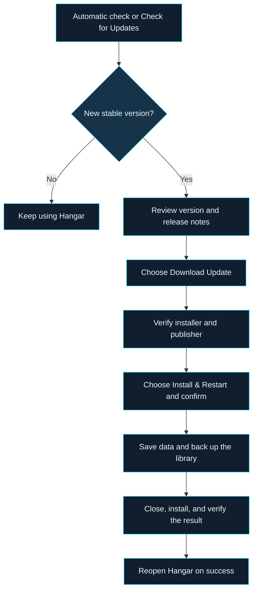

# HANGAR
### Organize. Prepare. Fly.

**Your Windows companion for Microsoft Flight Simulator 2024.**

[Downloads](#downloads) · [Automatic Updates](#automatic-updates) · [Distribution Contents](#distribution-contents) · [Help](#help)

---

Official distribution information for **Hangar**. This repository is reserved for installer releases and update metadata; desktop application development is maintained privately.

## Downloads

> **Coming soon.** No stable installer has been published here yet. Hangar's flightsim.to listing is not yet linked; a direct product-page link will be added when available.

**flightsim.to is the planned public download destination.** The [developer profile](https://flightsim.to/profile/TheAddonArchitect) is available for reference; it is not a direct Hangar download link.

### When the first stable release is available

1. Open Hangar's flightsim.to listing and review that version's requirements and release notes.
2. Download the Windows x64 installer provided with the release.
3. Run the installer and follow the setup prompts.
4. Launch Hangar and configure your simulator, Community, and addon-library locations.

The installer is configured for a per-user installation in `%LOCALAPPDATA%\Programs\Hangar`. Application data is kept separately in `%LOCALAPPDATA%\Hangar`, unless a custom data location is configured.

**Compatibility:** Windows x64 is the build target, with Microsoft Flight Simulator 2024 required for simulator-related features. Confirm the supported Windows versions and any additional requirements in the first stable release notes. No released compatibility matrix is available yet.

## Automatic Updates

**Automatic checks. You control installation.**

The current updater implementation enables automatic checks by default: at startup when a check is due, then every six hours while Hangar is running. Update checks and downloads do not require an account or sign-in. Internet access is required.

Select **Check for Updates** in the sidebar to check immediately. The **Application Updates** panel shows the installed version, update status, and available release notes. Use **Check Again** to retry, or turn off **Automatically check for updates**; the preference is saved.

### What happens during an update

- **Download and installation are separate actions.** Downloading does not close Hangar. You can choose **Later** at the installation confirmation.
- **Verification happens before installation.** Hangar checks the declared size, SHA-256 checksum, version, Windows signature, and approved publisher. The separate updater verifies the installer again before running it.
- **Finish active work first.** Installation is blocked during a library operation or flight recording, and if library storage is unhealthy.
- **Your data stays separate.** The installer replaces application files; settings, addon records, thumbnails, and saved profiles remain in the data folder. Hangar saves a pre-update library backup before starting installation.
- **Restart follows a successful installation.** The updater checks the installed version before reopening Hangar. If Windows needs a restart, it asks you to restart Windows first.

> **Availability:** The updater is implemented, but no stable update is published yet. In-app installation requires a build configured with an approved signing publisher and a matching signed release. Unsigned development installers are not accepted.

## Distribution Contents

The following describes the **configured release package**, not files currently available to download.

### Release files

| Item | Purpose |
|:---|:---|
| `Hangar-Setup-<version>-win-x64.exe` | Windows x64 installer, signed and verified by the production release process |
| `update-stable.json` | Stable-channel metadata: version, installer filename, size, SHA-256 checksum, and architecture |
| `SHA256SUMS.txt` | SHA-256 checksum for the installer |
| Public release notes | Release information displayed alongside the download and in the update panel; not a separate download asset |

### Inside the installer

| Component | Purpose |
|:---|:---|
| Hangar desktop application | Application binaries, resources, and bundled .NET / Windows App SDK runtime components |
| `Hangar.Updater.exe` | Separate helper for verified installation and restart |
| `Hangar-Cockpit.zip` | Packaged in-simulator companion addon; inclusion does not mean automatic installation into the simulator |
| User guide and supporting assets | Bundled PDF guide, application documentation, fonts, images, and embedded reference data |
| License and third-party notices | Terms and notices shipped with the application |

AI model files are not bundled by this packaging process. Your addon collection, personal settings, and saved library data are not part of the installer.

## Help

| Situation | Next step |
|:---|:---|
| “No stable updates have been published yet” | No stable release is available; continue using your existing build. |
| Update check fails or the server is busy | Check your connection and try **Check Again** later. Background failures do not interrupt your work. |
| Installation is unavailable | The build may lack an approved signing publisher. Wait for an official signed release. |
| Verification fails | Do not run that download manually to bypass verification. Retry through Hangar or use the official listing when available. |
| Installation fails | Keep the data folder intact. Update logs and the pre-update library backup remain under its `Updates` folder for troubleshooting. |

Support details will be added with the flightsim.to listing. When reporting a problem, include the Hangar version, Windows version, error message, and steps to reproduce; remove private information from logs and screenshots.

---

**HANGAR · Your Simulator. Your Addons. One Hangar.**

Independent third-party software for Microsoft Flight Simulator 2024. Not affiliated with or endorsed by Microsoft or Asobo Studio. For simulation use only.

